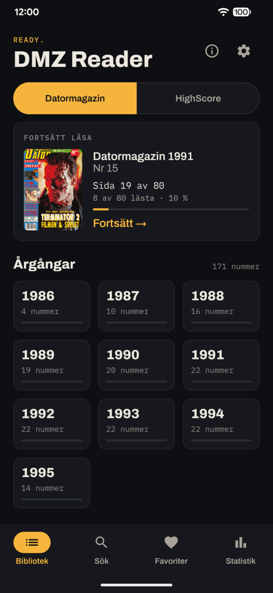
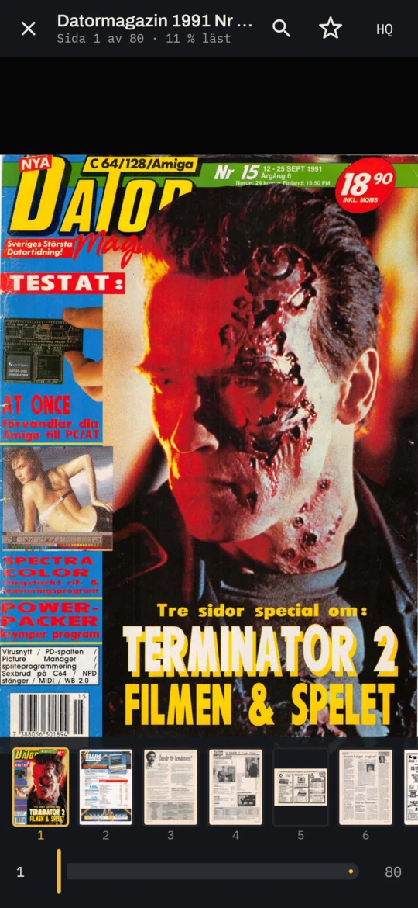
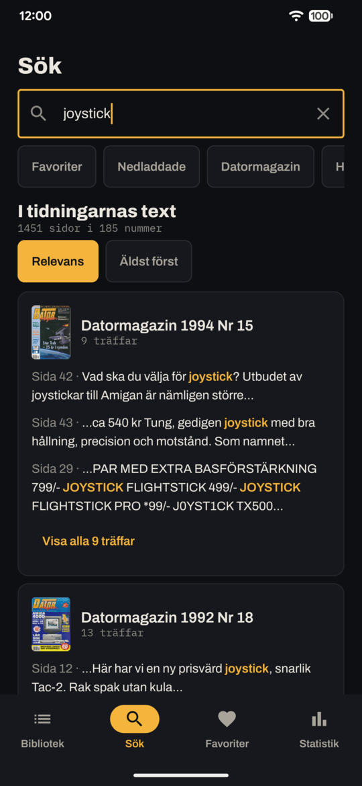
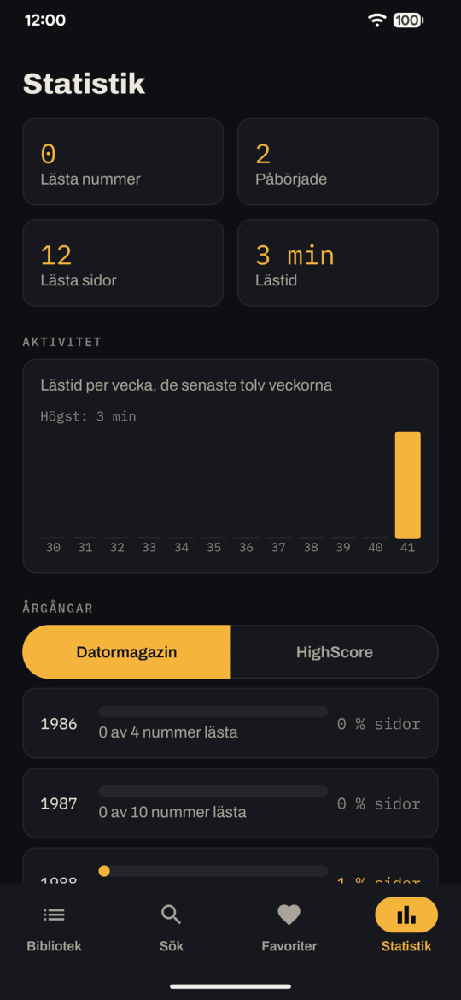

# DMZ Reader

DMZ Reader är en gratis Android-app för att läsa Datormagazin och HighScore från [DMZArkivet](https://dmzarkivet.se).

*A free Android reader for the Swedish computer magazines Datormagazin and HighScore from DMZArkivet.*

<table>
  <tr>
    <td align="center"><br>Bibliotek</td>
    <td align="center"><br>Läsare</td>
  </tr>
  <tr>
    <td align="center"><br>Sök</td>
    <td align="center"><br>Statistik</td>
  </tr>
</table>

**[Ladda ned senaste versionen](https://github.com/Rognils/dmz-reader/releases/latest)**

Kräver Android 8.0 eller senare.

## Vad appen gör

- **Bläddra** i 185 nummer (171 Datormagazin, 14 HighScore), årgång för årgång, med omslag.
- **Läs direkt eller ladda ned** för läsning utan nät. Nedladdningen fortsätter i bakgrunden och kan återupptas om den bryts.
- **Läsprogress som följer din läsning.** Appen kommer ihåg vilka sidor du har läst, även om du hoppar fram och tillbaka, och var du slutade.
- **Markera nummer** som lästa eller olästa.
- **HQ-läget** visar originalskanningen av en sida, för detaljer.
- **Favoriter och bokmärken.**
- **Fulltextsökning** i tidningarnas text, med ett valfritt sökindex.
- **Statistik** över läsning och årgångar.
- **Säkerhetskopiera och återställ** läsdata.
- **Ladda ned endast via wifi**, om du vill.
- **Ingen reklam, inga köp, inga konton, ingen spårning.**

## Tack, Gustav!

Ett stort tack till Gustav bakom DMZArkivet för arbetet med att samla in, skanna, OCR-behandla och tillgängliggöra de gamla tidningarna. Utan DMZArkivet hade den här appen inte funnits.

DMZ Reader är ett fristående projekt och inte en officiell app från DMZArkivet. Appen hämtar tidningarna direkt från arkivet när du läser eller laddar ned dem.

**Arkivet körs på en privat uppkoppling**, så ibland kan det vara tillfälligt otillgängligt. Nummer som du redan har laddat ned går att läsa ändå. En nedladdning som bryts fortsätter där den slutade när arkivet går att nå igen.

## Datormagazin idag

Datormagazin lever vidare genom Datormagazin Retro, med nya nummer om den klassiska datortiden. De nya utgåvorna ingår inte i DMZArkivet. De kan köpas som tidning och, för flera nummer, som PDF på [shop.datormagazin.se](https://shop.datormagazin.se).

## Installera

Appen finns inte i Google Play. Den installeras från en APK-fil och kräver Android 8.0 eller senare.

1. Hämta den senaste `dmz-reader-…-release.apk` under **Releases** här på GitHub.
2. Öppna filen på telefonen. Första gången frågar Android om webbläsaren eller filhanteraren får installera appar. Tillåt det.
3. Välj **Installera**.

En ny version installeras på samma sätt, ovanpå den gamla. Läsdata, bokmärken och nedladdade nummer ligger kvar.

Vill du kontrollera filen kan du jämföra APK:ns SHA-256 med den som står i release-texten.

## Sökindex

DMZ Reader fungerar utan sökindex. Indexet på cirka 90 MB behövs bara för fulltextsökning i tidningarnas text. Sökning på titel, år och nummer fungerar direkt.

Tryck **Ladda ned sökindex** i Sök-fliken eller under **Inställningar → Sökindex**. Appen hämtar indexet från den här sidans senaste release, kontrollerar det och importerar det. Hämtningen följer inställningen **Ladda ned endast via wifi**, och en avbruten hämtning fortsätter där den slutade.

Vill du hellre göra det för hand:

1. Hämta `search-….db` under **Releases** till telefonen.
2. Öppna **Inställningar** i appen och välj **Importera sökindex**. Finns det redan ett index heter knappen **Importera nytt sökindex**.
3. Välj filen. Appen kontrollerar den och säger till när sökningen är klar att använda. Efter importen kan du ta bort den hämtade filen.

Sökindexet tillämpar automatisk maskering av igenkända telefon- och faxnummer, e-postadresser, post- och bankgironummer och personnummerliknande mönster. OCR-skador kan innebära att en del uppgifter inte känns igen. I sökutdrag kan `•••` markera en maskerad uppgift. Tidningarna i läsaren är oförändrade.

## Licens

Källkoden är licensierad under MIT, se [LICENSE](LICENSE).

**Licensen gäller bara DMZ Readers källkod.** Tidningsmaterial, omslag, OCR-text, sökindex och annan arkivdata omfattas inte, och rättigheterna tillhör respektive rättighetsinnehavare. Se [NOTICE.md](NOTICE.md).

Rättighetsinnehavare som vill att material tas bort kan öppna ett ärende här på GitHub.

## För utvecklare

Inga tester kontaktar arkivet, och ingen arkivfil behövs för att köra dem. Testerna läser i ett påhittat nummer som följer med repot, och nedladdningar prövas mot en lokal server.

```
./gradlew :app:testDebugUnitTest                      # appens enhetstester
python3 -m unittest discover -s tools/tests           # verktygens tester
tools/device_test.sh                                  # testerna på en ansluten telefon
```

Verktygens tester kräver paketen i `tools/requirements.txt`. Testerna på telefonen körs i utvecklingsbygget, som ligger bredvid den vanliga appen och inte delar data med den. Installera det och testpaketet först:

```
./gradlew :app:assembleDebug :app:assembleDebugAndroidTest
adb install -r app/build/outputs/apk/debug/app-debug.apk
adb install -r app/build/outputs/apk/androidTest/debug/app-debug-androidTest.apk
```

En spärr i testbygget stoppar varje försök att nå dmzarkivet.se, och `tools/device_test.sh` kontrollerar efteråt att inget sådant försök gjordes.

Två skript ligger utanför testsviten och körs bara för hand: `tools/manual_archive_file_test.sh` prövar läsaren mot en arkivfil som du har skaffat själv, och `tools/live_archive_smoke_test.sh` gör några små förfrågningar till arkivservern. Mer finns i [tools/README.md](tools/README.md).

## Bygga själv

Appen byggs med Gradle och JDK 17:

```
./gradlew :app:assembleDebug
```

Ett release-bygge kräver en egen signeringsnyckel, se [docs/signing.md](docs/signing.md). Verktygen som förbereder arkivdata beskrivs i [tools/README.md](tools/README.md).
